# CareerCrew 架构全景文档

> 生成于 2026-10-08（基于 main 分支 commit `f44dc77` 时的代码实际状态）。
> 本文由全仓代码调研整理而成，与 README 少量不一致处以本文为准（差异点见 §10）。
> 流程图均为 Mermaid，可在 GitHub / IDE / Typora 中直接渲染。

---

## 目录

1. [项目定位与设计理念](#1-项目定位与设计理念)
2. [技术栈总览](#2-技术栈总览)
3. [系统总体架构](#3-系统总体架构)
4. [仓库结构与依赖方向](#4-仓库结构与依赖方向)
5. [核心子系统实现](#5-核心子系统实现)
   - 5.1 编排层（Supervisor + Agent 内核 + HITL）
   - 5.2 六大顾问 Agent
   - 5.3 工具层（注册表 / CDP 抓取 / 高风险闸门）
   - 5.4 三层记忆系统
   - 5.5 自建多模态 RAG
   - 5.6 多顾问会诊（Consult Orchestrator）
   - 5.7 API 层（认证 / NDJSON 流式 / 多租户）
   - 5.8 前端（React 19）
   - 5.9 MCP Server
   - 5.10 配置系统
6. [数据层（PostgreSQL / Qdrant / 文件）](#6-数据层)
7. [端到端功能流程图](#7-端到端功能流程图)
8. [部署与运维](#8-部署与运维)
9. [测试与 CI 质量门禁](#9-测试与-ci-质量门禁)
10. [实现要点与诚实备注](#10-实现要点与诚实备注)

---

## 1. 项目定位与设计理念

**CareerCrew = 多智能体"职业顾问团队"系统**，由 LangGraph supervisor 编排 6 个 AI 顾问 Agent（职位匹配 / 简历 / 面试 / 谈薪 / 规划 / 知识库），围绕**自建多模态 RAG、三层记忆、HITL 人工闸门**三大底座，长期陪跑用户整个求职周期：意向 → 规划 → 岗位匹配 → 简历定制 → 模拟面试 → 薪资谈判 → 投递（人工确认）→ 跟踪 → 复盘。

核心设计理念：

- **多角色协同天然成立**：匹配 / 简历 / 面试 / 谈判 / 规划本就是求职中的专业分工，一个角色对应一个 Agent；
- **高 stakes 决策 → HITL 是底线**：投递、打招呼等高风险动作默认拦截等用户确认，而非"锦上添花"；
- **长期记忆**：跨会话记住用户画像、面试经历、投递历史，才能"陪跑"；
- **全链路可观测**：LangSmith 追踪每一次 LLM / 工具 / RAG / 记忆调用，默认脱敏上传；
- **质量闭环**：点赞点踩 → 坏例归因 → 升级为评测 case → 离线评测回归门禁。

---

## 2. 技术栈总览

| 分类 | 技术（★ = 当前生效配置） |
|------|------|
| 后端 | Python 3.12、FastAPI ≥0.115、Uvicorn、Pydantic v2、Alembic、psycopg3（连接池） |
| Agent 编排 | LangGraph ≥1.2（StateGraph / conditional edges / interrupt / Command）、LangChain 1.x `create_agent` + 自定义 5 件 Middleware、langgraph-checkpoint-postgres |
| LLM | ★阿里云百炼 DashScope（OpenAI 兼容协议）`qwen-plus`，temperature 0.3 / max_tokens 4096；`langchain init_chat_model` 薄适配 |
| Embedding | **BGE-M3 本地三合一**（FlagEmbedding，dense 1024 + sparse + colbert），CPU / fp16 off，batch 12 |
| Rerank | ★阿里云百炼 `gte-rerank-v2`（top_m 30）；备选：硅基流动 `bge-reranker-v2-m3`、多模态 `Qwen3-VL-Reranker-8B`、本地 ColBERT MaxSim |
| VLM（看图作答） | ★百炼 `qwen-vl-max`（`vlm_answer` / `read_image` 工具） |
| 文档解析 | MinerU（默认云端 API，可切本地子进程），PDF/图片/docx/pptx/xlsx → 页面 Markdown + 对象裁剪图 |
| 向量库 | Qdrant（唯一后端，named vectors：`text_dense` COSINE + `text_sparse`，可选 `text_colbert` MAX_SIM） |
| 关系库 | PostgreSQL 16（唯一关系库：账号 / 会话 / 记忆 / checkpoint / 求职域，共约 69 张表，Alembic 管理） |
| 前端 | React 19.2 + TypeScript + Vite 8 + Tailwind 3.4（class 暗色模式）+ Zustand 5 + react-router-dom 7 + react-markdown 10；无 axios（纯 fetch 封装）、无 i18n |
| 真实岗位抓取 | patchright（Playwright 反检测分支）`connect_over_cdp` 接管用户已登录 Chrome（9222 调试端口），Boss直聘 + 猎聘双渠道 |
| 认证 | argon2（PasswordHasher 3/64M/4/32）、PyJWT HS256 access token（15 min）+ HttpOnly Cookie 不透明 refresh token 一次性轮换 |
| 可观测 | LangSmith 全链路追踪（`traced_call` 根 run + 脱敏 anonymizer）、Prometheus `/api/metrics`、组件级 `/api/health` |
| 测试 | pytest（unit / integration / e2e / api 四层 + diff-cover 变更行覆盖 ≥80%）、Vitest 3 + Testing Library（51 个测试文件与源码同目录） |
| 部署 | Docker 多阶段构建 + Compose 三服务（app / postgres / qdrant），GitHub Actions 8 类 CI job + nightly |
| 外部服务 | 百炼（LLM/rerank/VLM）、MinerU（解析）、LangSmith（追踪，可选）、阿里云 OSS（头像，可选，未配置回退本地）、Exa（仅 `scripts/fetch_kb.py` 抓语料） |

---

## 3. 系统总体架构

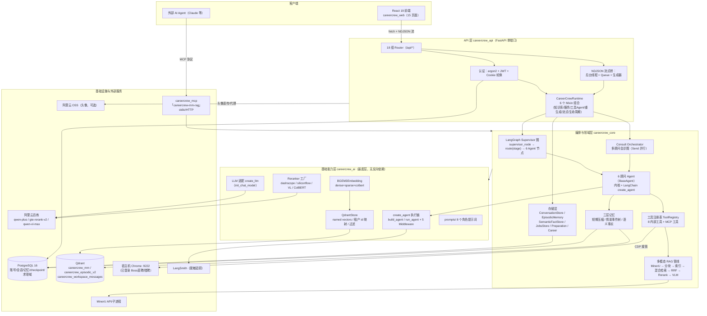

**依赖方向（单向，编译期保证）**：`careercrew_ai` ← `careercrew_core` ← `careercrew_api`（前端经 HTTP 调 API）；`careercrew_mcp` 独立进程，复用 `careercrew_core` + `careercrew_ai` 的同一套 RAG 组件。

**编排模式说明（"端点即编排"）**：生产 API 采用「一个模块端点直连一个 Agent」换取流式的简单可控（`/api/chat/plan` → career_planner、`/api/chat/match` → JobMatcher…）；LangGraph supervisor 图用于**多阶段自动流转**场景——目前真实驱动 JobCycle M1 闭环（match → resume 自动流转，`careercrew_core/workflow/job_cycle.py`）。会诊则是独立的 Orchestrator 图。

---

## 4. 仓库结构与依赖方向

```text
CareerCrew/
├── careercrew_ai/            # 最底层：LLM 适配 / BGE-M3 / reranker / QdrantStore / splitter / create_agent 执行链 / prompts
│   ├── llm/llm_adapter.py                # create_llm()：init_chat_model 薄封装
│   ├── embedding/bge_m3_embedding.py     # BGEM3Embedding：一次前向出三路向量
│   ├── reranker/                         # dashscope / siliconflow / VL reranker + ColBERT
│   ├── vector_store/qdrant_store.py      # 唯一向量后端（建集合/检索/租户映射/治理过滤）
│   ├── splitter/recursive_splitter.py    # Markdown 感知递归切分（800/100）
│   ├── agents/langchain_agent.py         # build_agent/run_agent + 5 个 Middleware
│   └── prompts/                          # 8 个角色提示词（job_matcher/interviewer/...）
├── careercrew_core/          # 领域层：supervisor + agents + 三层记忆 + 工具注册表 + RAG + 会话存储 + 配置
│   ├── supervisor/                       # graph.py / router.py / hitl.py / consult*.py
│   ├── agents/base_agent.py              # BaseAgent（历史恢复+记忆注入+执行+state 更新）
│   ├── workflow/job_cycle.py             # M1 闭环（match→resume 自动流转）
│   ├── memory/                           # episodic / semantic / compaction / router / injection / consolidation
│   ├── rag/                              # pipeline_multimodal / retrieval / chunking / loaders / vlm_answer
│   ├── tools/                            # registry.py + internal/ + browser/(CDP) + jobs/
│   ├── conversation/store.py             # ConversationStore（turn/message/run/反馈/质检）
│   └── state/                            # CareerCrewState / checkpointer / settings.py
├── careercrew_api/           # FastAPI：main.py + auth/ + routers/(18 组) + runtime/(6 Mixin) + sse.py
├── careercrew_mcp/           # MCP server「careercrew-mm-rag」：ingest/search/query/status
├── careercrew_web/           # React 19 前端（src/pages 15 页面、store×3、lib 领域 client）
├── config/settings.yaml      # 主配置（${VAR} 占位 → 环境变量替换 → pydantic 校验）
├── config/settings.docker.yaml  # 容器变体（生产口径）
├── migrations/               # Alembic：0001_baseline(pg_dump 全量 24 表) → 0018，单线 18 版
├── scripts/                  # 知识入库 / 评测 / 迁移 / Chrome CDP 启动脚本
├── tests/                    # unit / integration / e2e / api 四层 pytest
├── docs/                     # DEV_SPEC / 运维备份 / Docker 迁移 / 技术债
├── Dockerfile                # 多阶段：Node 构建前端 → Python venv → 运行时组装
├── docker-compose.yml        # postgres + qdrant + app 三服务一键编排
└── .github/workflows/        # CI：unit/api/typecheck/frontend/eval/docker-build/security/nightly
```

---

## 5. 核心子系统实现

### 5.1 编排层：Supervisor + Agent 内核 + HITL

#### Supervisor 图（`careercrew_core/supervisor/graph.py`）

- `build_graph(agents, checkpointer)` 构建 `StateGraph(CareerCrewState)`；
- **`supervisor_node` 是空节点**——不写 state、不调 LLM，只承担路由枢纽；图中没有任何模型调用，智能行为全部下沉到 Agent 节点内的 `create_agent`；
- 边：`START → supervisor`，`add_conditional_edges("supervisor", route)`；**每个 Agent 节点执行完无条件回环到 supervisor**；
- 阶段路由 `STAGE_AGENT_MAP`（`router.py:9`）：intent/planning/review → career_planner，match/track → job_matcher，resume → resume_advisor，interview → interviewer，negotiate → salary_negotiator，**apply → `__end__`（图级闸门，投递阶段直接终止图）**；
- 流程推进靠 Agent 改 state.stage（如 `_matcher_node` 返回 `{"stage": "resume"}` 触发下一跳；`"done"` 不在映射中 → END）。

#### 状态定义（`state/thread_state.py:37`）

`CareerCrewState(TypedDict)`：`messages`（`add_messages` reducer 累积）、`agent_outputs`（自定义 `merge_dicts` 多 Agent 产出按键合并不覆盖）、`stage`、`pending_action`（HITL）、`synthesis`（会诊综合）等。

#### Agent 内核（`careercrew_ai/agents/langchain_agent.py`）

`BaseAgent.__init__` 调 `build_agent()` 编译 LangChain 1.x `create_agent` 子图，装配 5 个自定义 Middleware：

| Middleware | 职责 |
|---|---|
| `MaxIterationsMiddleware` | `before_model` 计数 + `wrap_model_call` 超限短路（不依赖不稳定的 recursion_limit 崩溃路径）；`wrap_tool_call` 把工具异常转 `ToolMessage("Error: ...")` 回喂不中断循环；工具结果钳制 6000 字符 |
| `HitlMiddleware` | 对 `requires_confirmation` 工具**短路不执行**，回喂"需要用户确认"ToolMessage，记录 `blocked_tool_calls` |
| `UsageAccumulatorMiddleware` | 累计 input/output tokens |
| `ObservabilityMiddleware` | 逐工具计时 / 记录 args / error |
| `ContextCompactionMiddleware` | 超阈值时旧消息 LLM 摘要替换（保留区 + 宽限期 + **CJK 感知 token 估算**——修复了 `len//4` 对中文低估 3-4 倍导致压缩永不触发的 bug） |

`run_agent()` 驱动 `agent.stream(stream_mode=["messages","updates"])`：`messages` 流做 token 级流式回调（经 `PseudoToolCallStreamFilter` 拦截伪工具调用块），`updates` 流聚合迭代明细；`recursion_limit = max_iterations*3 + 10`（1.3 版 before_model 是独立节点，每轮耗 3 个 super-step）。返回 `AgentResult{content, iterations, tool_calls_total, stopped_reason, tokens, blocked_tool_calls}`。

#### HITL 的三层实现

1. **库级原语**（`supervisor/hitl.py`）：`interrupt_for_confirmation()` 抛 `langgraph.types.interrupt` 暂停图，`resume(decision)` 用 `Command(resume=...)` 恢复——**设计契约已备，交互式恢复协议尚未接入生产流**；
2. **生产 MVP（block-and-record）**：`HitlMiddleware` 短路高风险工具 → `blocked_tool_calls` → 落库 `agent_run_tool_calls.status=awaiting_confirmation`；
3. **工具元数据闸门**：`ToolSpec.requires_confirmation`（`tools/registry.py:26`），生效名单来自 `settings.yaml` `tools.hitl.requires_confirmation: [submit_application]`。

#### Checkpointer（`state/checkpointer.py`）

唯一后端 Postgres `PostgresSaver`（autocommit 连接 + `setup()` 建表）；租户隔离 `tenant_thread_id(user_id, thread_id)` 生成长度前缀内部 id `tenant:{len}:{user}{thread}` 防碰撞。注：主对话链路的会话历史由 `ConversationStore`（Source of Truth）+ `history_loader`（恢复最近 10 轮）+ compaction 承接，checkpointer 服务于 supervisor 图的多阶段流转。

---

### 5.2 六大顾问 Agent

全部是 `BaseAgent`（`agents/base_agent.py:24`）薄壳：prompt 文件缺失时回退硬编码 `_DEFAULT_PROMPT`；`run(state)` 前先做两件事——①`history_loader` 从 conversation 表恢复历史消息；②`memory_injector` 生成画像 preamble 作为 SystemMessage 插最前；执行后返回 `{"messages": [AIMessage(name=...)], "agent_outputs": {...}}`。

| Agent | 文件 | max_iterations | 绑定工具（实际在 API 层 `_make_tools` 按 kind 注册） | 专属确定性函数 |
|---|---|---|---|---|
| JobMatcher 职位匹配官 | `agents/job_matcher.py` | — | search_jobs、rag_query(岗位)、memory_write/search、profile_update、submit_application(HITL)、send_greeting | `score_jd_match`（JD 相似度）、`extract_profile_from_intent`（只提取用户亲口说的字段） |
| ResumeAdvisor 简历顾问 | `agents/resume_advisor.py` | — | rag_query(简历)、profile_update | `resume_match_score`（JD 技能覆盖率） |
| Interviewer 面试官 | `agents/interviewer.py` | — | rag_query(面经+简历)、memory_write/search | `score_answer`（LLM 五维评分）、`record_interview_qa`（逐题写情景记忆） |
| SalaryNegotiator 谈判师 | `agents/salary_negotiator.py` | — | rag_query、salary_query、profile_update、memory_search | — |
| CareerPlanner 规划师 | `agents/career_planner.py` | — | rag_query、salary_query、profile_update、memory_search | — |
| KnowledgeAdvisor 知识库顾问 | `agents/knowledge_advisor.py` | 15 | rag_query（用户选范围）、read_image、memory_search | `include_tool_call_text=False`——只向用户展示最终正文，隐藏检索过程话术 |

工具集还要经过三层裁剪：`compute_effective_tools`（client ∩ server allowlist ∩ 角色权限 ∩ 模块开关，`tools/effective.py:41`）→ memory policy 裁剪 → planner 意图级收窄（正则命中薪资/资料意图才放开 salary_query）。**每次请求新建 Agent 实例**，避免并发串写内部状态。

---

### 5.3 工具层：注册表 / CDP 抓取 / 高风险闸门

#### 统一注册表（`tools/registry.py`）

`ToolSpec{tool, source: internal|mcp, requires_confirmation, parallel_safe}` + `ToolRegistry`（register 同名覆盖 / bindable_tools / high_risk_names / execute）。内部工具与 MCP 工具同一接口注册。

#### `search_jobs`——三态分支（`tools/internal/search_jobs.py:160`）

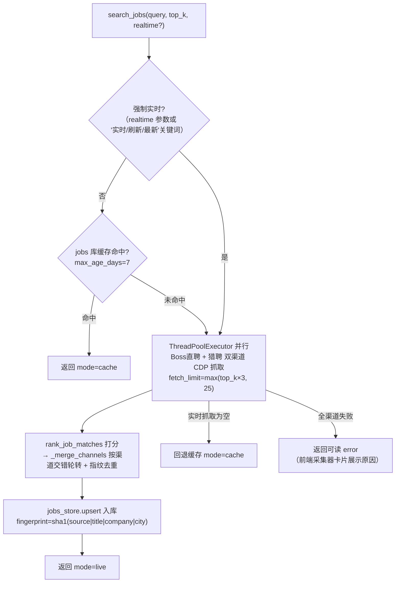

#### CDP 接管真实 Chrome（`tools/browser/`）

- **通道本体** `cdp.py`：`resolve_cdp_url` 先把域名解析成 IP（绕过 Chrome DevTools 的 DNS-rebinding Host 防护）；`open_cdp_page` 用 **patchright**（Playwright 反检测分支）`connect_over_cdp` 接管 `localhost:9222` 的已登录 Chrome，**每次采集新建连接用毕即断**（sync 对象绑线程，线程池复用会崩），`browser.close()` 只断连接不关用户浏览器；
- **Boss直聘** `boss_search.py`：城市码解析 → 搜索页 → `human_pause()` 拟人停顿 → 风控探测 `_looks_blocked`（命中则抛"请手动通过验证"）→ DOM 解析岗位卡 → **`_decode_salary` 破解 Boss 列表页私有字体**（0xE031-0xE03A → 0-9，未知私有字符输出"薪资请打开岗位链接查看"）；
- **猎聘** `liepin_search.py`：城市 dqs 参数剥离防双重过滤、滚动加载、多级 DOM 兜底解析；
- Docker 部署时容器经 `host.docker.internal:9222` 访问宿主机 Chrome，`tools.browser.local_guard: container` 放行 Docker 网桥网段；
- 无 CDP 时回退 MCP 子进程方案（`tools/jobs/mcp_jobs.py`，Playwright 爬猎聘，约 1-2 分钟）。

#### 其余内部工具

| 工具 | 实现要点 |
|---|---|
| `rag_query` | `MultimodalSearch.search` → 可选 CRAG 自评估（incorrect 时 LLM 重写重检一轮）→ 每条结果回调 `sink`（前端来源收集）→ 输出带 `[image: 路径]` 行 |
| `memory_search` | 优先 `memory_service.search`（policy 门控 + trace 审计），否则语义事实 LLM 路由 + 情景向量检索双路拼接 |
| `memory_write` | `redact_content` 密钥正则打码 → `MemoryService.write_event`（**拒绝写入 user_message/agent_response transcript 类型**，只允许 job_match/application/interview_qa/offer 等重要事件） |
| `profile_update` | `SemanticFactStore.update` 字段白名单 13 项；空值=显式清空；每字段落一条事实、version 递增留痕 |
| `salary_query` | 每会话上限 2 次（闭包计数）→ 爬猎聘薪资样本 → 聚合中位数 / min·max / 年薪折算 |
| `read_image` | VLM 看图作答；`path_authorizer` 做路径归属校验防越权读图 |
| `send_greeting`（真实打招呼） | Boss 详情页"立即沟通" → 按 JD+简历生成 120 字招呼语 → 发送 → **成功判定 = 输入框被清空**；`record_apply_attempt` 写情景事件，失败可检索重试 |
| `submit_application` | HITL 闸门示例工具，被 `HitlMiddleware` 拦截记录 |

---

### 5.4 三层记忆系统（仿 Hermes）

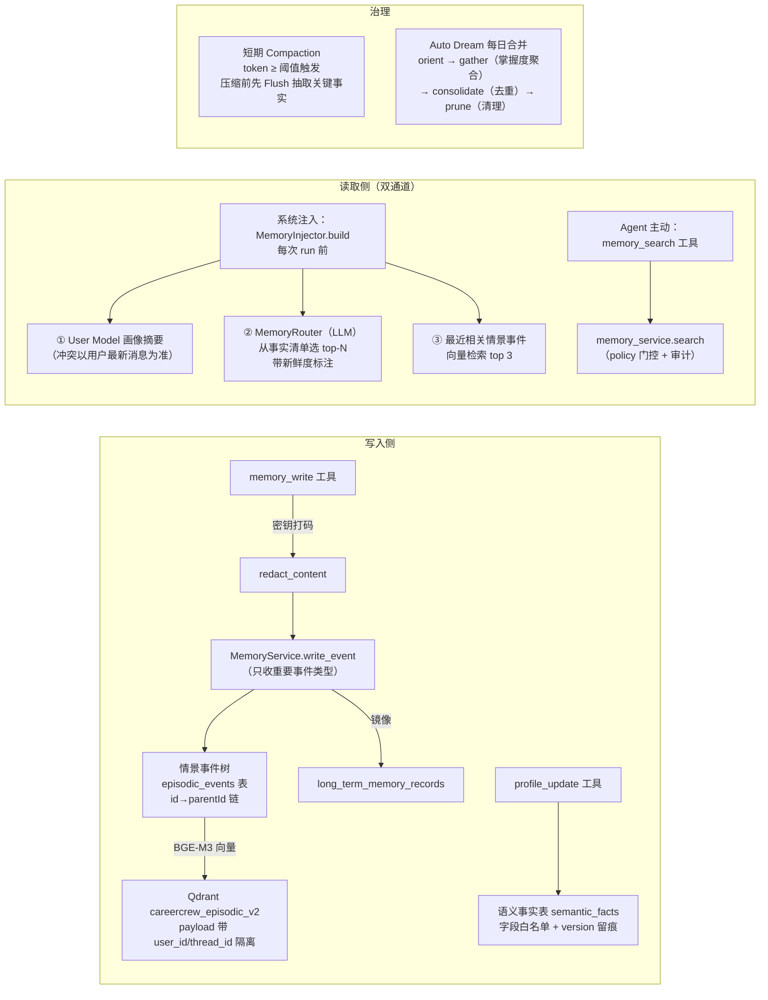

**短期（Context Window 压缩）**——两处实现：独立版 `Compactor`（`memory/compaction.py`，`should_compact` 按 token 阈值，压缩区分块摘要、保留区原样，**M2 Pre-compaction Flush**：压缩前先 LLM 抽取 skills/target_companies/preferences 写语义事实防丢失，压缩条目写回情景记忆）；Agent 内联版 `ContextCompactionMiddleware`（每次模型调用前检查，3 次宽限防反复压缩，失败静默降级）。

**情景（append-only 事件树）**：`MemoryEntry{id, parentId, type, ts, content}`；`EpisodicMemory.write` 在 `db.write_lock` 内原子完成"取 id → 接最新父节点 → 插入"（防并行写串线程）；id 用 MAX+1 而非 COUNT（删除后防复用覆盖）；Postgres 表 `episodic_events`（PK(user_id, id)）+ Qdrant `careercrew_episodic_v2` 双存储；从叶子沿 parentId 回溯 = 完整历史轨迹。

**长期（语义事实 / 用户画像）**：`SemanticFactStore`（每字段一条事实，source/confidence/version）；注入时 `MemoryRouter` 用 **LLM 从事实清单选 top-N**（不做向量检索，失败回退关键词重合）；总预算 `max_inject_tokens`。

**Auto Dream 后台合并**（`memory/consolidation.py` + `api/dream.py`）：守护线程按 `dream_schedule`（"HH:MM"，默认 off）遍历全部账号，Consolidator 内部再过门控（距上次 ≥24h 且新增会话 ≥5）；四阶段：orient 盘点 → gather 按 interview_qa 得分聚合各主题掌握度 → consolidate 同名事实去重 → prune 删"低置信度 <0.5 且 >30 天未更新"。

**多租户**：`tools_agents.py` 强制 `episodic is None → ValueError`——所有租户级 Agent 工具闭包必须捕获 user_id；记忆表全部 PK 含 user_id。

---

### 5.5 自建多模态 RAG

#### 摄取管线（`rag/pipeline_multimodal.py:33`）

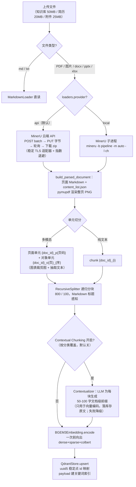

#### QdrantStore（`careercrew_ai/vector_store/qdrant_store.py:41`）

- 统一 schema：named vectors `text_dense`(1024, COSINE) + `text_sparse`（SparseVectorParams），可选 `text_colbert`（MultiVectorConfig MAX_SIM，存量集合自动 patch 补加）；
- **点 id 稳定映射**：业务字符串 id 用 `uuid.uuid5` 映射（owner 作用域租户命名空间 / legacy 两个 namespace 防碰撞），原始 id 存 `payload._id`，幂等 upsert；
- 17 个 payload 字段建 KEYWORD 索引（owner_user_id / visibility / governance_* 等）；
- 访问控制翻译：`__access_user` → Qdrant 过滤器 `visibility=public OR owner_user_id=本人`，与其他 must 条件共存时以嵌套 `Filter(min_should=1)` 并入，**防止访问控制被可选 OR 短路**。

#### 检索链路（`rag/retrieval/multimodal_search.py:38`）

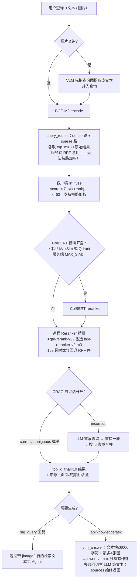

#### Agentic RAG

`QueryRouter`（关键词启发：记忆类"上次/记得/面过" → memory，时效类"最新/行情" → web，否则 kb）+ `QueryDecomposer`（LLM 判断多跳拆 1-3 子查询）+ `AgenticSearch`（主查询 + 子查询检索 → RRF 融合）。

---

### 5.6 多顾问会诊（Consult Orchestrator）

`careercrew_core/supervisor/consult_orchestrator.py:443` —— 生产用的"总调度官"图（编译**无 checkpointer**，每次请求即建即弃）：

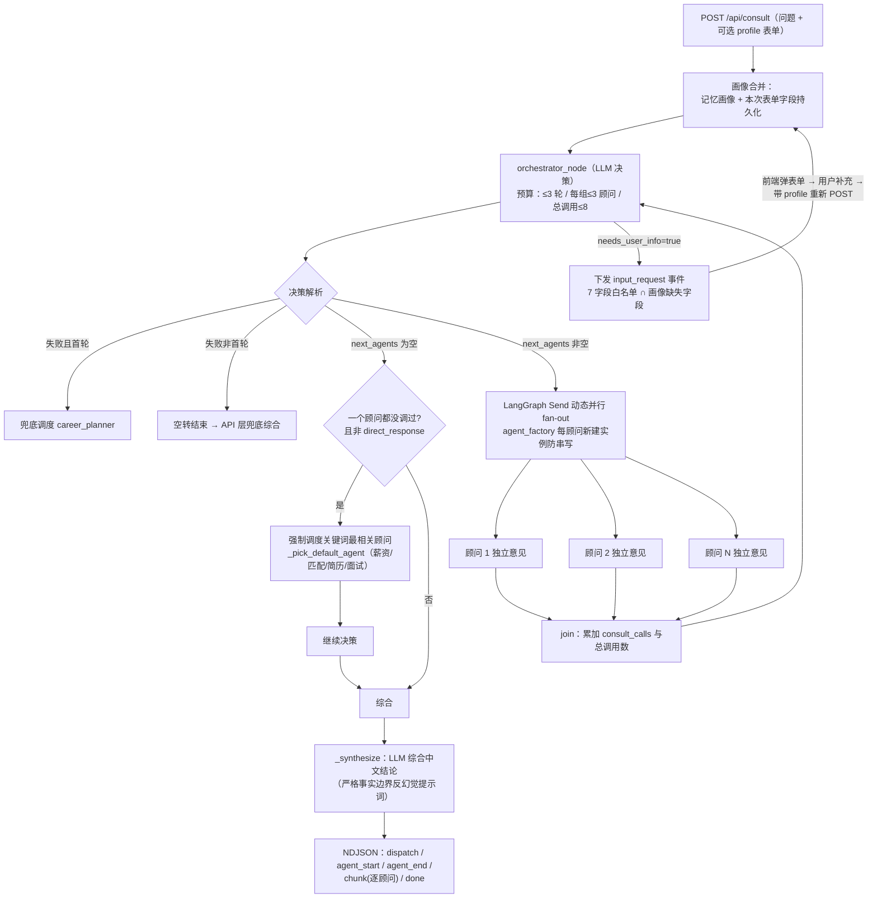

决策 prompt 内置 prompt-injection 防护段与事实边界约束；JSON 解析失败重试一次；**API 恢复协议 = "带 profile 重发提问"**，服务端不挂起会话。

---

### 5.7 API 层：认证 / NDJSON 流式 / 多租户

#### 应用组装（`careercrew_api/main.py:205 create_app`）

- 中间件：CORS（trusted_origins）→ `TrustedOriginMiddleware`（仅对 `/api/auth/refresh`、`/api/auth/logout` 两个 Cookie 端点校验 Origin，CSRF 第二道闸）→ `request_id_middleware`（X-Request-ID + 访问日志 + HTTP 指标）；
- lifespan 初始化：中断上传任务恢复、refresh 会话清理线程（6h）、附件 TTL 清理线程（24h）、HR 监控（Boss 未读拉取，默认关）、Dream 调度器；**重组件 Runtime 不在此初始化，全部惰性**；
- 探针：`/healthz`（进程存活）、`/readyz`（PG `SELECT 1` + Qdrant `get_collections`，任一失败 503）、`/api/health`（组件级明细，需登录）；
- 生产托管前端：`dist/` 存在时挂 `/assets` 静态目录 + SPA fallback（`/api/*` 一律 404 JSON 防误吞接口；路径 `resolve + is_relative_to` 防目录穿越）；
- 全局异常：`RuntimeInitError` → 503 中文、422 中文汇总、兜底 500 中文 + 追踪号。

#### 认证（`auth/service.py` + `auth/store.py`）

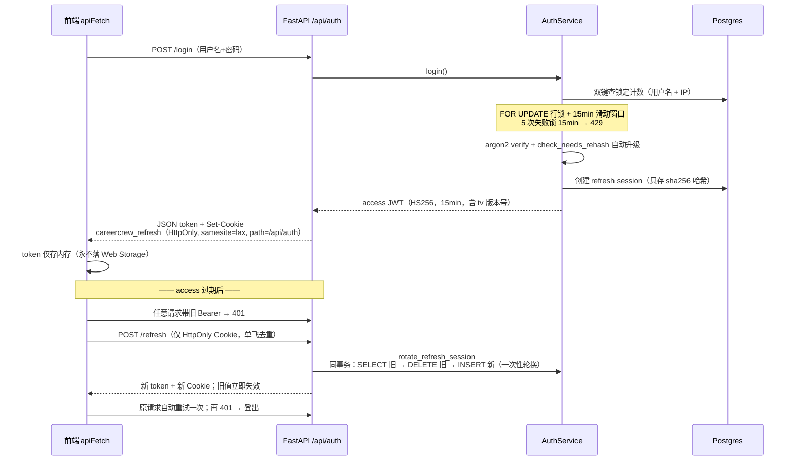

- 角色模型：`admin / user / quality_reviewer`（DB CHECK 约束）；依赖注入 `CurrentUser / AdminUser / QualityReviewer`；**quality_reviewer 只允许 `/api/quality/*` 与白名单**；
- `bump_token_version`（tv）= 全端登出；强制改密白名单 `{/me, /password, /logout}`；
- admin 保护不变量：不能改/删自己、保证至少一名在任 admin、删号先清理全部业务数据（会话/记忆/附件 DB+磁盘/向量副本/头像）；
- bootstrap 初始管理员（固定 `u_001`）仅 development 环境可用；管理员开户密码留空 → 默认 `123456` + 强制首登改密。

#### NDJSON 流式（`sse.py` + `runtime/streaming.py`）

事件协议（`careercrew_api/sse.py:7`）：

| 事件 | payload | 用途 |
|---|---|---|
| `stage` | stage | 阶段提示（match / resume / questions / consult / knowledge / regenerate） |
| `chunk` | text, agent? | token 级流式文本；会诊时带 agent 名分桶 |
| `agent_start` / `agent_end` | agent | 仅会诊，驱动调度胶囊 UI |
| `done` | content, sources?, jobs?, score?, thread_id, turn_id, message_id, run_id… | 终结事件，携带全部稳定 ID |
| `error` | message | 友好化中文错误 + 追踪号（原始异常不外泄） |
| `input_request` | message, fields | 会诊 HITL 资料表单 |

实现：`stream_agent(run_fn)` 把同步 Agent 放**后台 daemon 线程**跑，`stream_callback` 经 `put_nowait` 非阻塞入队（队列满丢弃计数防背压卡死），哨兵保证终结事件必达；空闲超时 300s → error；客户端断开（GeneratorExit）→ `cancel.set()`。停止生成 = 前端 `AbortController` + `POST /api/chat/cancel` 双通道，worker 在阶段边界协作式停止。响应统一 `application/x-ndjson + no-cache + X-Accel-Buffering: no`。

#### 一轮对话的完整生命周期

`chat_lifecycle.begin_turn`（"四件套先落库，中断不丢问题"）：`ensure_conversation`（UUIDv7 主键）→ `next_turn`（sequence_no=MAX+1 冲突重试）→ user message(completed) → assistant message(streaming) → `start_run`（module/agent/model/effective_tools）→ Agent 执行（LangSmith `traced_call` 根 run）→ `_finish_chat_turn`：写 assistant 内容 + `finish_run`（tokens/latency/langsmith_run_id）+ 观测落库（`agent_run_retrievals` 逐条召回打分 / `agent_run_tool_calls` 含 HITL 状态）+ usage 计费 + 首轮 LLM 生成会话标题。

**重新生成（版本切换）**：`POST /api/messages/{id}/regenerate` 带 `Idempotency-Key`（原子预留：命中 replay 直接回放首次结果、进行中 409 杜绝双跑）；新 assistant message 带 `regenerated_from_message_id` 形成版本链，旧 run 的 module/agent/model/prompt_version 忠实复用保证可比；前端 `VersionSwitcher` 按 turn 归组切换 `< 1/2 >`。

#### Runtime 层（`careercrew_api/runtime/`）

`CareerCrewRuntime` = 6 个 Mixin 组合（KnowledgeDocs / Services / ToolsAgents / Regenerate / Streaming / TurnLifecycle / HeavyInit），进程级双检锁单例 `get_runtime()`。**两级惰性初始化**（`heavy.py`）：

1. `_ensure_stores()`：纯 Postgres 轻量层（memory_db / jobs_store / conversation_store / attachment_store 等）——AI 栈故障不影响历史恢复；
2. `_ensure_heavy()`：双检锁 + 失败统一 `RuntimeInitError`→503（BGE-M3 / Qdrant / LLM / reranker / MultimodalSearch / 摄取管线 / MemoryInjector / LangSmith）。

测试用 `FakeRuntime` duck-type + `app.dependency_overrides` 替换。

#### 多租户隔离（纵深）

- **owner_id 永远来自服务端 JWT**，客户端不可传；ConversationStore 每方法带 user_id 且 `_require_owned`（不存在也按 OwnershipError 拒绝，不泄露资源存在性）；
- SQL 层每条 WHERE 含 user_id；Agent 工具闭包强制捕获 user_id（None 即抛错）；
- 知识库向量：payload `owner_user_id/visibility` → Qdrant 过滤器；图片读取按 `metadata_exists` 校验归属；
- 文件系统：`data/uploads/attachments/{user_id}/{thread_id}/...` 目录级隔离 + `resolve_under` 防穿越。

#### 附件系统

25MB 上限（1MB 分块流式读取，超限即断防内存 DoS）、每会话 ≤5 个、7 天 TTL（转存知识库后取消）；四维校验：扩展名白名单 + MIME 一致 + **magic bytes 签名**（`%PDF-` / `PK\x03\x04` / PNG/JPG）+ 文本类 UTF-8 校验；"存入知识库" 202 异步任务：md/txt 直读、二进制走 MinerU 多模态管线（owner=本人、private）。对话注入：图片走 VLM 描述、二进制走 MinerU 解析，单块 3 万字符截断。

#### 头像 OSS

零第三方依赖的阿里云 OSS V1 预签名实现（标准库 hmac-sha1）；上传预签名 PUT 直传、读取**同源代理返回**（bucket 无需公开读）；四要素任一缺失回退本地 `data/uploads/avatars/`。

---

### 5.8 前端（React 19）

#### 结构与路由

- 无 `<Routes>`：`App.tsx` 用一张 `PAGES` 精确路径映射 + 正则兜底（未匹配回退 ChatPage）；**15 个页面全部 `lazy()` 按页拆 chunk**；
- 页面：`/` 求职规划对话、`/matcher` 岗位匹配（CDP 状态条 + 岗位卡片）、`/interview` 模拟面试（逐题评分 + 语音输入）、`/resume` 简历定制、`/knowledge` 知识库、`/consult` 多顾问会诊、`/preparation` 岗位准备、`/career` 求职中心（9 Tab）、`/workspace` 工作台（4 Tab）、`/settings` 个人设置、`/admin/users` 用户管理、`/quality*` 质检三页、`/share/:token` 导师只读分享页（认证门旁路）；
- 角色守卫：非 admin 访问 admin 页、非 quality_reviewer 访问质检页 → 强制 `<Navigate to="/">`（后端 403 兜底）。

#### 状态管理（无 persist 中间件，持久化仅主题 localStorage）

| Store | 管什么 |
|---|---|
| `chatStore` | 当前对话页消息、threadId、选中 JD、上次匹配结果 |
| `threadStore` | 6 个模块各自的会话列表 / 当前会话 / 后台完成未读蓝点 / 置顶 / 检索范围 / legacy id remap |
| `streamStore` | **每会话独立流状态** `sessions[threadId]`（status / streamingText / agentChunks / dispatch / opinions / pendingInput / doneIds…）；模块级 `AbortController` Map |
| 认证（非 Zustand） | `useSyncExternalStore` 订阅的模块级内存 token |

#### NDJSON 流式消费（`streamStore.start()`，6 个对话页共用）

`fetch + resp.body.getReader() + TextDecoder` 手动按行缓冲 → 逐行 `JSON.parse` 分派 8 类事件；**50ms `scheduleFlush` 合并刷盘**防每 token 全页重渲染；`chunk.agent` 有值时逐顾问分桶；`done` 时稳定 ID 回写消息（regenerate 追加为新版本）、legacy thread_id 三处整体 re-key、不在当前查看的会话打蓝点。停止 = 本地 abort + `POST /api/chat/cancel`。

#### API Client（`lib/auth.ts`，无 axios）

唯一入口 `apiFetch`：内存 token 注入 `Authorization` → **401 单飞刷新**（`refreshInFlight` Promise 去重，凭 HttpOnly Cookie）→ 重试一次 → 再 401 登出。领域 client（preparation/career/workspace/quality/attachments…）全部基于它。

#### 关键交互

- 消息流：react-markdown + remarkGfm、Turn 分组 + 会话内搜索高亮、👍👎 反馈（点踩带原因 Popover，绑定后端稳定 messageId 进质检闭环）；
- 岗位卡片：绝不解析 LLM 正文（done 事件的 `jobs` 结构化字段）；收藏时无 JD 先调 `capture-jd`（后端 CDP 打开详情页采集）再收藏；
- 简历工作台：左右对照编辑，每次保存生成**不可变版本**；PDF/DOCX 导出调后端渲染、前端仅 blob 下载；
- 知识库：上传进度轮询（解析→向量化→入库）、scope=public/private × 分类正交过滤、带认证的图片 objectURL + Lightbox；
- 会诊：dispatch 胶囊（第 N 轮调度了谁）、`pendingInput` 弹 7 字段资料表单、逐顾问分桶渲染意见；
- 面试：`pendingRef` 记住"当前作答对应题目"，done 带评分计入 qaList；本地启发式语音分析（语速/口头禅/STAR 完整度）。

---

### 5.9 MCP Server（`careercrew_mcp/`）

`FastMCP("careercrew-mm-rag")`，暴露 4 个工具：`ingest_document`（本地路径/URL → 多模态入库）、`search`（文本/图片混合检索）、`query`（检索 + VLM 看图回答）、`status`。`_Runtime.ensure()` 进程级单例惰性装配与 API 侧同一套 core/ai 组件（但不含治理/owner 过滤——面向本地 Agent）。Transport 默认 **stdio**（`python -m careercrew_mcp`），`--http` 启用 Streamable HTTP；启动前重导入预热避免事件循环线程内 import 死锁。

---

### 5.10 配置系统

加载链（`careercrew_core/state/settings.py:474`）：

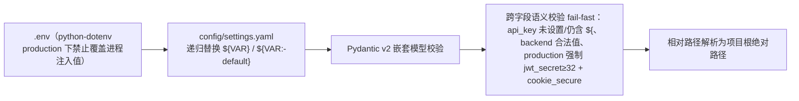

顶层 14 段：`llm / embedding / rerank / vector_store / rag(retrieval+chunking+loaders) / vlm / supervisor(checkpointer) / memory(postgres+episodic+compaction+router+consolidation) / tools(registry+hitl+search+browser) / hitl / langsmith / auth / oss / hr_monitor`。Docker 变体（`settings.docker.yaml`，经 `CAREERCREW_SETTINGS_PATH` 启用）差异：模型路径 `/models/bge-m3`、Qdrant 走服务名、langsmith/memory 关闭、CDP 走 `host.docker.internal:9222` + `local_guard: container`、auth production 口径（cookie_secure=true、origins 收窄）。

---

## 6. 数据层

### PostgreSQL 16（唯一关系库，Alembic 单线 18 版迁移，全库约 69 张表）

| 域 | 表 |
|---|---|
| 认证 | auth_accounts、auth_refresh_sessions（只存 sha256）、auth_login_attempts（双键锁定） |
| 会话/运行 | conversations（UUIDv7）、conversation_turns、messages（metadata JSONB 存 mentions/attachments/jobs）、agent_runs（effective_tools JSONB）、agent_run_retrievals（召回/精排/排序前后/used_in_final）、agent_run_tool_calls（requires_hitl/hitl_status）、regeneration_keys（幂等）、chat_attachments（expires_at 索引） |
| 记忆 | episodic_events（PK(user_id,id)、parent_id 链）、semantic_facts（PK(user_id,name)、version）、memory_global_policy / user_memory_policy、long_term_memory_records、记忆治理事件 |
| 求职域 | jobs（fingerprint 主键）、岗位准备 opportunities/versions、求职中心 board/tasks/materials/followups/contacts/offers/real_interviews、简历母版/素材/导出任务、分享令牌（SHA-256） |
| 质量闭环 | message_feedback、feedback_snapshots（90 天过期脱敏快照）、feedback_reviews(+events)、feedback_audit_log、eval_cases（bad-case 升级入口） |
| 其他 | upload_tasks（租约恢复）、tool 策略覆盖与审计、admin_audit_events、LangGraph checkpoints/writes |

- **0001_baseline** 是 `pg_dump --schema-only` 冻结的 24 表全量快照；此后新增字段一律走新 migration，各 store 惰性建表仅作开发兜底；`tests/integration/test_alembic_baseline.py` 双库一致性守卫拦漂移；
- app 容器启动前自动 `alembic upgrade head`，迁移失败不半启动。

### Qdrant（3 个集合，应用自动创建）

| 集合 | 用途 |
|---|---|
| `careercrew_mm` | 知识库（页面/对象单元，payload 带 owner/visibility/governance 元数据） |
| `careercrew_episodic_v2` | 情景记忆向量（payload 带 user_id/thread_id/type） |
| `careercrew_workspace_messages` | 工作区消息语义检索 |

### 文件布局（目录级 owner 隔离）

`data/uploads/attachments/{user_id}/{thread_id}/{uuid}`、`data/uploads/knowledge_raw/{user_id}/…`、`data/parsed/…`（MinerU 产物）、`data/uploads/avatars/…`（OSS 回退）、`data/eval/`（评测基线）。

---

## 7. 端到端功能流程图

### 7.1 一轮流式对话（以 /api/chat/plan 为例）

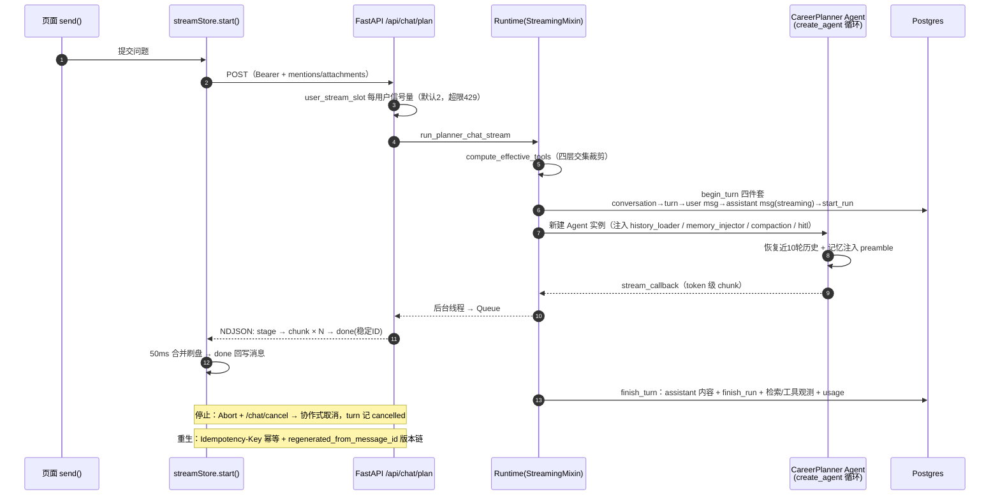

### 7.2 Supervisor 多阶段流转（JobCycle 闭环）

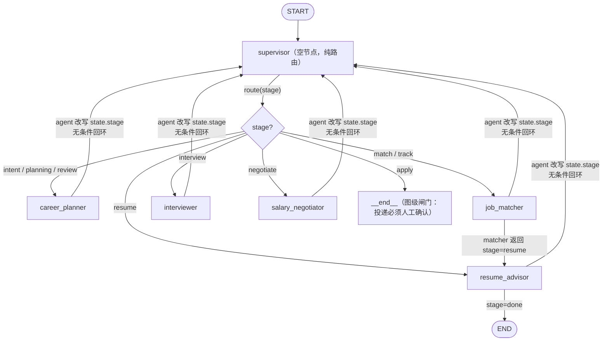

### 7.3 三层记忆读写全景

```mermaid
flowchart TD
    subgraph 每轮对话前
        A["Agent.run"] --> B["MemoryInjector.build"]
        B --> C["画像摘要 + LLM 路由事实(带新鲜度) + 向量情景 top3<br/>→ SystemMessage 插最前"]
    end
    subgraph 对话中
        D["Agent 调 memory_write / profile_update"]
        D --> E["redact 打码 → 重要事件类型校验"]
        E --> F["episodic_events（append-only 父子链）"]
        E --> G["semantic_facts（字段级 version 留痕）"]
        F --> H["Qdrant careercrew_episodic_v2"]
    end
    subgraph 对话中-上下文维护
        I["ContextCompactionMiddleware<br/>CJK 感知 token 估算超阈值"]
        I --> J["先 Flush 抽取关键信息入语义事实<br/>再摘要压缩旧消息"]
    end
    subgraph 每日低峰（dream_schedule，默认 off）
        K["Dream 调度器"] --> L["Consolidator 四阶段：<br/>orient → gather 掌握度 → consolidate 去重 → prune 清理"]
        L --> G
    end
    subgraph Agent 主动检索
        M["memory_search 工具"] --> N["policy 门控 + 审计 → 语义事实 + 情景向量双路"]
    end
```

### 7.4 岗位准备闭环（match → preparation → interview）

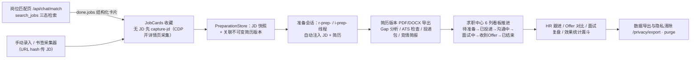

### 7.5 质量闭环（反馈 → 评测门禁）

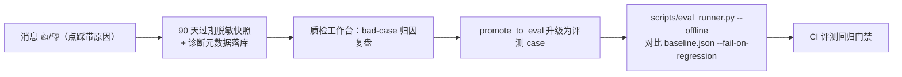

### 7.6 部署拓扑（docker compose）

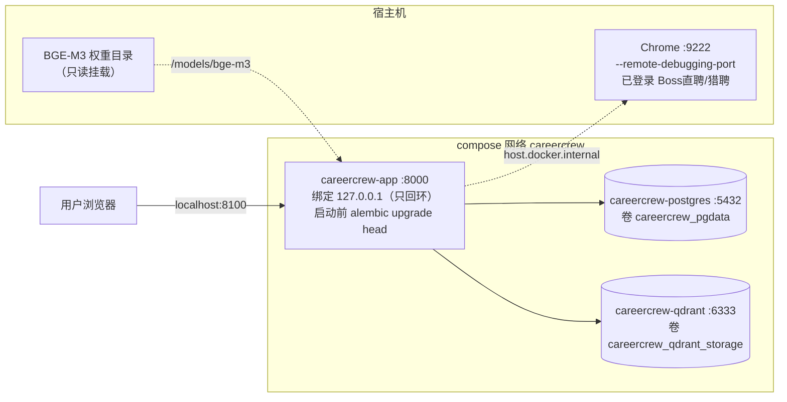

---

## 8. 部署与运维

- **一键启动**：`cp .env.example .env`（必填 `DASHSCOPE_API_KEY`、`AUTH_JWT_SECRET`、`CAREERCREW_EMBEDDING_MODEL_DIR`）→ `docker compose up -d --build` → `/readyz` 应返回 `{"status":"ready","checks":{"postgres":"ok","qdrant":"ok"}}`；
- **本地开发**：独立容器起 PG/Qdrant（仅向宿主机回环发布 5432/6333）→ `uvicorn careercrew_api.main:app --reload --port 8100` + `npm run dev`（5276 端口，`/api` 代理到 8100）；生产模式 `npm run build` 后由 FastAPI 单端口托管 + SPA fallback；
- **端口绑定安全**：compose 只绑定 `127.0.0.1`——采集需要后端反向控制宿主机 Chrome（`local_guard` 放行 Docker 网桥网段），公网可达性由这条绑定挡住；
- **镜像**：三阶段（Node 编译前端 → Python 装 CPU 版 torch 全量 ML 依赖 → 运行时组装 venv + dist），支持 `PIP_PROXY` 构建代理；
- **数据卷**：`careercrew_pgdata` / `careercrew_qdrant_storage` / `careercrew_app_uploads`，容器重建不清数据；`down -v` 才会清；
- **备份**：PG dump / Qdrant snapshot / 文件哈希流程见 `docs/运维手册/备份恢复.md`；旧数据迁移见 `docs/运维手册/Docker迁移记录.md`。

---

## 9. 测试与 CI 质量门禁

**后端 pytest 四层**：

| 层 | 命令 | 说明 |
|---|---|---|
| unit | `pytest -q tests/unit/` | 90 个文件，无外部依赖 |
| api | `pytest -q tests/api` | FakeRuntime 注入，需本机 Postgres |
| integration | `pytest -q -m integration` | 需 `POSTGRES_TEST_DSN`（含 Alembic 基线守卫） |
| e2e | `-m "integration or e2e"` | 求职闭环端到端 |

**前端**：Vitest 3 + Testing Library，51 个测试文件与源码同目录（colocation），jsdom 逐文件 pragma 开启；覆盖 streamStore 流解析 / auth 刷新 / 各领域 lib / 会话组件 / 页面冒烟。

**CI（GitHub Actions）**：push main / PR 触发 unit、api（Postgres 服务容器 + 覆盖率）、postgres-memory、typecheck（ruff + compileall）、frontend（oxlint + tsc -b + vitest）、eval-sanity、docker-build（镜像构建 + 容器内迁移冒烟）、security-audit（pip-audit）八类任务；**diff-cover 变更行覆盖率 ≥80% 门禁**；nightly 定时跑 integration/e2e；dependabot 周检五类生态。

**评测回归门禁**：`python scripts/eval_runner.py --offline --compare data/eval/baseline.json --fail-on-regression`（CI 同样执行）。

---

## 10. 实现要点与诚实备注

调研中发现的设计权衡与文档-代码差异，后续维护值得知道：

1. **"端点即编排"为主，supervisor 图为辅**：单阶段对话走模块端点直连 Agent 换取流式可控；supervisor 图真实驱动 JobCycle 的 match→resume 自动流转；会诊是独立的 Orchestrator 图。DEV_SPEC §2 有诚实声明。
2. **HITL 现状**：生产链路是 block-and-record MVP（拦截高风险工具、记录 `awaiting_confirmation`），LangGraph `interrupt`/`Command(resume)` 恢复原语已备好但交互式 approve/reject 尚未接入聊天流；**会诊的 input_request 表单是另一条已接通的 HITL 通道**（"带 profile 重发"语义，无需服务端挂起）。
3. **README / DEV_SPEC 中已过时的描述**（以当前 `config/settings.yaml` 为准）：
   - LLM 实际指向**阿里云百炼 DashScope `qwen-plus`**，不是硅基流动（`llm_adapter.py` 头注释是历史遗留）；
   - Rerank 实际用 **`gte-rerank-v2`（dashscope 后端）**，硅基流动 reranker 与 VL reranker 是可切换备选；
   - VLM 实际用 **`qwen-vl-max`**；`GLM-4.5V` 只是 `read_image` 工具里的兜底常量名；
   - Checkpointer 已是 **Postgres**（非早期 SQLite 方案）。
4. **Docker 变体关闭记忆系统**（`memory.enabled: false`）且不预设 dream_schedule（容器时区不定）；本地开发默认开启。
5. **Embedding 无缓存层**：每次摄取实时编码 BGE-M3（约 2GB 权重，lazy import + 惰性初始化，首请求 10-30s 属正常）。
6. **search_jobs 的缓存语义**：本地 jobs 库缓存优先（7 天新鲜度），`realtime` 参数或"实时/最新"类关键词穿透缓存触发双渠道并行抓取；Boss 薪资需破解列表页私有字体，未识别字符降级为提示文案。
7. **流式桥的取舍**：core 的同步 `stream_callback` 接缝 + API 层"后台线程 + Queue + NDJSON 生成器"，对 core 零侵入；代价是取消只能协作式（当前 LLM 调用自然结束才真正停）。
8. **每请求新建 Agent 实例**与 `JobCycle` LRU（32 个 `(user, thread)` 键）并存：前者防工具闭包状态串写，后者承载多轮跨请求的工作流上下文。
